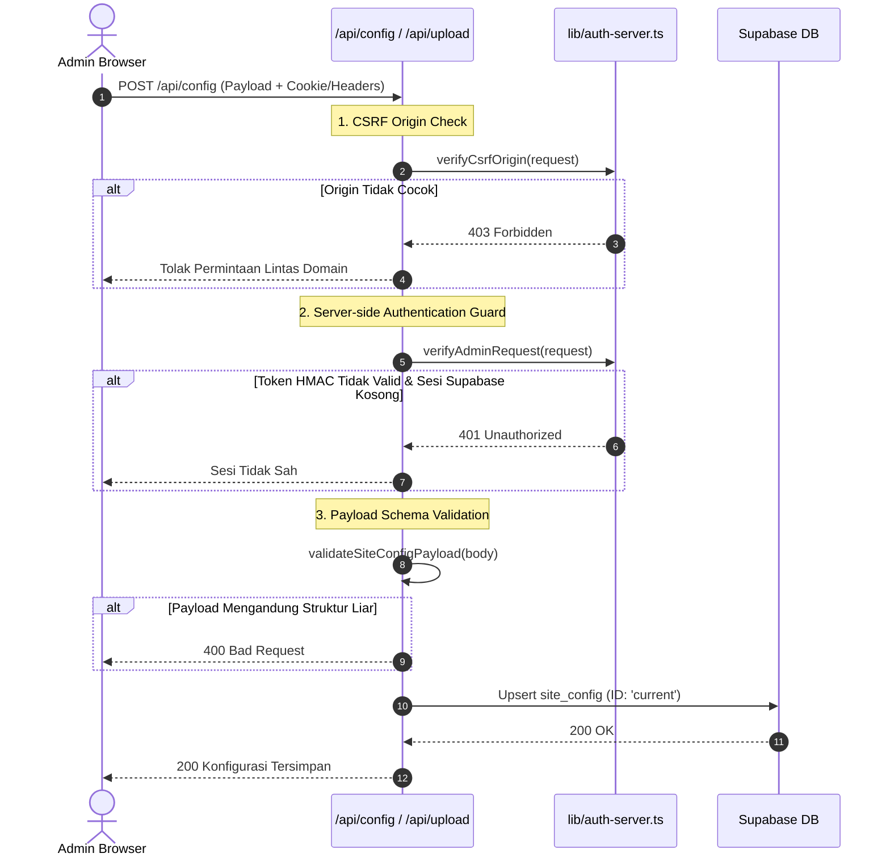

# Arsitektur Sistem — ZekkTech Portfolio

Dokumentasi arsitektur resmi untuk repositori [Portofolio_Web](https://github.com/ZekkCode/Portofolio_Web) milik Zakaria Mujur Prasetyo (ZekkTech).

---

## 1. Ikhtisar Aplikasi

Situs ini adalah **Hybrid Single-Page Portfolio & Interactive 3D Showcase** yang dibangun menggunakan:
- **Framework**: [Next.js](https://nextjs.org) 16 (App Router + Turbopack).
- **Core Runtime**: [React](https://react.dev) 19 + [TypeScript](https://www.typescriptlang.org) 5.
- **Styling**: [Tailwind CSS](https://tailwindcss.com) v4.
- **3D Physics & Visuals**: [Three.js](https://threejs.org) (r186) untuk simulasi tali lanyard dan manipulasi fisik lembaran CV.
- **Scroll Engine**: [Lenis](https://github.com/darkroomengineering/lenis) (smooth scroll) + [GSAP ScrollTrigger](https://greensock.com/scrolltrigger/) untuk sinkronisasi scroll dua arah.
- **Cloud Infrastructure**: [Supabase](https://supabase.com) (PostgreSQL + RLS + RPC) dan [Cloudflare R2](https://www.cloudflare.com/products/r2/) (S3-compatible Object Storage).

---

## 2. Diagram Aliran Data & Komponen

```mermaid
flowchart TD
    subgraph Browser ["Klien (Browser)"]
        UI["React 19 Virtual DOM & UI Islands"]
        Store["Zustand / LocalStorage ('zekk:site:v1')"]
        WebGL["Three.js Canvas (Lanyard & PaperCrumple)"]
        Scroll["Lenis + GSAP ScrollTrigger"]
    end

    subgraph NextServer ["Next.js Server / Vercel Edge"]
        SSR["Server Component Pre-rendering (HTML)"]
        APICv["/api/cv-pdf (Signed URL / Allowlist Local)"]
        APIViews["/api/views (Rate-Limiter & Deduplikasi)"]
        APIConfig["/api/config (CSRF & HMAC Auth Guard)"]
        APIUpload["/api/upload (MIME & Size Validator)"]
    end

    subgraph SupabaseCloud ["Supabase Database (PostgreSQL)"]
        RLS["Row Level Security (RLS)"]
        TableConfig["public.site_config (ID: 'current')"]
        TableViews["public.page_views (ID: 'portfolio')"]
        TableLog["public.project_views (24h Window)"]
        RPCInc["increment_page_view() [SECURITY DEFINER]"]
    end

    subgraph CloudflareCloud ["Cloudflare R2 Storage"]
        Bucket["Bucket: 'zekk-portfolio'"]
        CDN["Custom Domain / CDN Cache"]
    end

    UI <--> Store
    UI --- WebGL
    UI --- Scroll
    
    Browser -- "HTTP GET / (SSR HTML)" --> SSR
    Browser -- "POST /api/views (Beacon)" --> APIViews
    Browser -- "GET /api/cv-pdf?role=..." --> APICv
    Browser -- "POST /api/config (Admin)" --> APIConfig
    Browser -- "POST /api/upload (Admin File)" --> APIUpload

    APIViews -- "Atomic RPC" --> RPCInc
    RPCInc --> TableViews
    APIViews -- "Deduplikasi 24h" --> TableLog
    APIConfig <--> TableConfig
    
    APICv -- "Generate Presigned URL" --> Bucket
    APIUpload -- "PutObject (S3 SDK)" --> Bucket
    Bucket --> CDN
    CDN -- "Stream Gambar / PDF" --> UI
```

---

## 3. Alur Kerja Arsitektur Inti

### 3.1. Halaman Publik & Dual Rendering Strategy
1. **Prerender Statis (SSG/SSR)**:
   - File [`src/app/layout.tsx`](file:///e:/ProjectZekk/Porotofolio-Zekk/src/app/layout.tsx) memuat metadata SEO, skema terstruktur JSON-LD (`WebSite`, `Person`, `ProfilePage`), serta font Google (`Space_Grotesk`, `Plus_Jakarta_Sans`, `Pixelify_Sans`) secara *zero-layout-shift* (`display: swap`).
   - Konten semantik (Heading 2 baris Hero, Tentang, Layanan, Sertifikat, FAQ, dan Footer) diproses sebagai HTML awal yang langsung terbaca oleh perayap mesin pencari (*search engine bot*) tanpa bergantung pada hidrasi JavaScript.
2. **Interactive Islands (Client Components)**:
   - Komponen berbasis WebGL Three.js ([`Lanyard`](file:///e:/ProjectZekk/Porotofolio-Zekk/src/components/lanyard.tsx), [`Folder`](file:///e:/ProjectZekk/Porotofolio-Zekk/src/components/folder.tsx), [`PaperCrumple`](file:///e:/ProjectZekk/Porotofolio-Zekk/src/components/paper-crumple.tsx)) dan listener navigasi scroll ([`PortfolioPillNav`](file:///e:/ProjectZekk/Porotofolio-Zekk/src/components/portfolio-pill-nav.tsx)) dimuat sebagai modul klien (`'use client'`).
   - Tersedia mekanisme deteksi kapabilitas browser (`hasWebGL`) dan preferensi aksesibilitas (`prefers-reduced-motion`) untuk menampilkan fallback statis elegan bila perangkat klien tidak mendukung WebGL.

### 3.2. Pola *Graceful Fallback* (Zero External Blocker)
Situs dirancang dengan prinsip *offline-first / local-resilient*:
- **Konfigurasi Situs**: Klien membaca dari `localStorage` (`zekk:site:v1`). Jika variabel `NEXT_PUBLIC_SUPABASE_URL` tidak tersedia, aplikasi tetap berjalan 100% menggunakan data bawaan (`src/lib/profile.ts` dan `src/lib/site-config.ts`).
- **Counter Pengunjung**: Jika Supabase offline, counter beralih ke cache in-memory dan berkas lokal `.views.json`.
- **Aset & Dokumen CV**: Jika Cloudflare R2 belum disetel, route `/api/cv-pdf` menyajikan berkas lokal otentik ATS PDF dari direktori `public/`.

---

## 4. Mekanisme Keamanan (Trust Boundary)

1. **Autentikasi Dua Jalur**:
   - *Jalur Sesi Standar*: Cookie signed HMAC-SHA256 (`zekk_admin_session`) dengan flag `HttpOnly`, `SameSite=Lax`, dan `Secure` di lingkungan produksi.
   - *Jalur Supabase*: Autentikasi token Bearer atau sesi Supabase SSR terverifikasi dengan email admin resmi (`zakariamujur6@gmail.com`).
2. **Proteksi Row Level Security (RLS)**:
   - Pembacaan log visitor pada tabel `project_views` hanya diberikan kepada role `authenticated`.
   - RPC `increment_page_view` diamankan dengan `SECURITY DEFINER` dan hak akses publik `anon` dicabut untuk mencegah manipulasi angka sembarangan.
3. **Penyaringan Berkas CV**:
   - Endpoint `/api/cv-pdf` menerapkan allowlist ketat nama berkas, ekstensi `.pdf`/`.png`, serta validasi batas path (`path.relative` check) guna mencegah *Directory Traversal* dan *Open Redirect*.

---

## 5. Ringkasan Modul & Pustaka

| Kategori | Teknologi | Peran Teknis Utama |
| :--- | :--- | :--- |
| **Framework** | Next.js 16 (Turbopack) | Server-Side Rendering, API Routes, Asset Optimization, Edge Middleware |
| **UI Library** | React 19 + TypeScript 5 | Reaktifitas komponen, tipe data aman (*type-safety*), concurrent rendering |
| **Gaya** | Tailwind CSS v4 | Utilitas styling modern, tema gelap/terang dinamis tanpa layout shift |
| **3D Rendering** | Three.js (r186) | Mesh procedural kartu lanyard, vertex deformation kertas remas, shadow map |
| **Scroll & Motion** | Lenis + GSAP ScrollTrigger | Smoothing lerp scroll fisik, timeline animasi scroll folder & navigasi |
| **Database** | Supabase (PostgreSQL) | Penyimpanan konfigurasi dinamis, atomic counter, deduplikasi kunjungan |
| **Storage** | Cloudflare R2 (S3 SDK) | Hosting aset resolusi tinggi, foto profil, dan dokumen karier |
