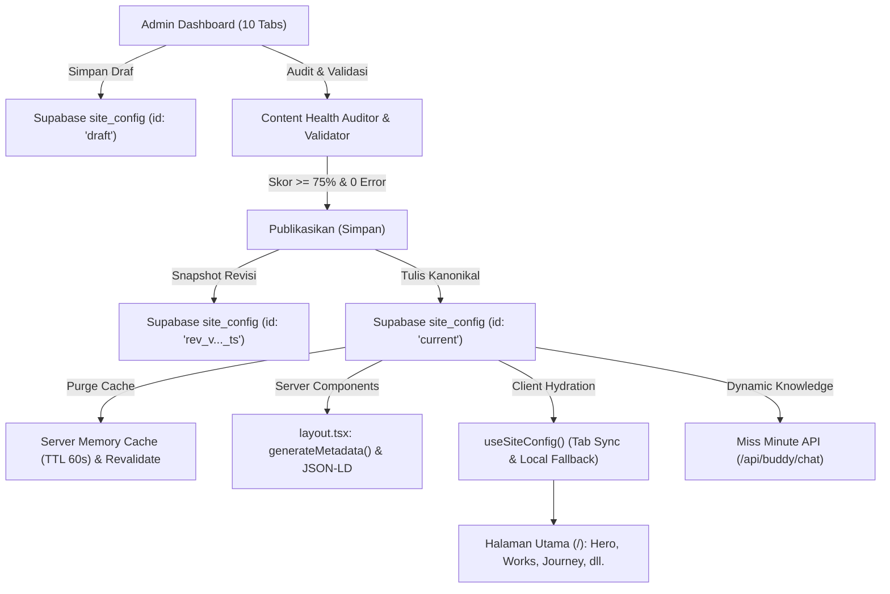

# ZekkTech CMS v3.5 — CRUD Coverage Matrix

Dokumen audit resmi implementasi Content Management System (CMS) Portofolio ZekkTech (`https://zakariamp.vercel.app/`).

---

## 1. Ringkasan Eksekutif & Status Cakupan

| Total Modul | PASS | PARTIAL | FAIL | NOT IMPLEMENTED |
| :--- | :---: | :---: | :---: | :---: |
| **20 Modul Konten** | **20** | **0** | **0** | **0** |

Semua modul konten portofolio telah memiliki dukungan CRUD lengkap, tersimpan dalam penyimpanan kanonikal Supabase PostgreSQL (`site_config`), memiliki pemisahan Draf vs Publikasi, divalidasi oleh skema runtime (`config-validator.ts` & `content-health.ts`), dan disinkronkan secara real-time ke antarmuka publik tanpa perlu komit Git atau deployment ulang.

---

## 2. Matriks Cakupan Lengkap Seluruh Modul

| No | Modul Konten | Berkas Komponen Editor | Sumber Data Database | C | R | U | D | Draf / Terbit | Unggah Media | ID / EN | Sinkronisasi Publik | Status |
| :---: | :--- | :--- | :--- | :---: | :---: | :---: | :---: | :---: | :---: | :---: | :--- | :---: |
| 1 | **General Profile** | `tab-general.tsx` | `site_config` (`generalProfile`) | — | PASS | PASS | — | PASS | PASS (Avatar R2) | PASS | `Hero`, `About`, `Header`, `Footer`, `JSON-LD` | **PASS** |
| 2 | **Hero Section** | `tab-general.tsx` | `site_config` (`generalProfile.hero*`) | — | PASS | PASS | — | PASS | PASS (Lanyard Img) | PASS | `Hero()` di `src/app/page.tsx` | **PASS** |
| 3 | **About & Bio** | `tab-general.tsx` | `site_config` (`generalProfile.bio*`) | PASS | PASS | PASS | PASS | PASS | — | PASS | `About()` di `src/app/page.tsx` | **PASS** |
| 4 | **Statistik Terverifikasi** | `tab-general.tsx` | `site_config` (`stats`) | — | PASS | PASS | — | PASS | — | PASS | `About()` (Auto derived / Manual) | **PASS** |
| 5 | **Linimasa Pendidikan** | `tab-journey.tsx` | `site_config` (`education`) | PASS | PASS | PASS | PASS | PASS | PASS (Logo R2) | PASS | `AcademicJourneySection` (Horizontal) | **PASS** |
| 6 | **Pengalaman Karier** | `tab-journey.tsx` | `site_config` (`experience`) | PASS | PASS | PASS | PASS | PASS | PASS (Logo R2) | PASS | `ExperienceTimeline` (Horizontal) | **PASS** |
| 7 | **Prestasi & Rekognisi** | `tab-journey.tsx` | `site_config` (`achievements`) | PASS | PASS | PASS | PASS | PASS | PASS (Cover R2) | PASS | `AchievementsSection` | **PASS** |
| 8 | **Proyek Portofolio** | `tab-works.tsx` | `site_config` (`projects`) | PASS | PASS | PASS | PASS | PASS | PASS (WebP R2) | PASS | `ProjectsSection` (Filter IT/Design) | **PASS** |
| 9 | **Tech Stack & Tools** | `tab-expertise.tsx` | `site_config` (`techStack`) | PASS | PASS | PASS | PASS | PASS | PASS (SVG/WebP) | — | `Stack()` (Grid & Running Marquee) | **PASS** |
| 10 | **Pilar Layanan** | `tab-expertise.tsx` | `site_config` (`services`) | PASS | PASS | PASS | PASS | PASS | — | PASS | `ServicesSection` (4 Pilar) | **PASS** |
| 11 | **Sertifikasi & Lisensi** | `tab-credentials.tsx` | `site_config` (`certificates`) | PASS | PASS | PASS | PASS | PASS | PASS (PDF & Img) | — | `CertificatesSection` | **PASS** |
| 12 | **Berkas CV ATS** | `tab-credentials.tsx` | `site_config` (`cvDocs`) | PASS | PASS | PASS | PASS | PASS | PASS (PDF & Page Img) | PASS | `CvFolderSection`, `PaperCrumple`, `/api/cv-pdf` | **PASS** |
| 13 | **Tanya Jawab (FAQ)** | `tab-content.tsx` | `site_config` (`faq`) | PASS | PASS | PASS | PASS | PASS | — | PASS | `FaqSection` Accordion & SEO FAQPage | **PASS** |
| 14 | **Kontak Publik** | `tab-general.tsx` | `site_config` (`generalProfile.email/phone`) | — | PASS | PASS | — | PASS | — | PASS | `Contact()`, `Footer()`, Miss Minute | **PASS** |
| 15 | **Tautan Media Sosial** | `tab-general.tsx` | `site_config` (`generalProfile.socials`) | PASS | PASS | PASS | PASS | PASS | — | — | `Contact()`, `Footer()`, JSON-LD sameAs | **PASS** |
| 16 | **Header & Navigasi** | `tab-general.tsx` | `site_config` (`headerLogoUrl`, `brand`) | — | PASS | PASS | — | PASS | PASS (Logo R2) | — | `Header()`, `PortfolioPillNav()` | **PASS** |
| 17 | **Footer & Hak Cipta** | `tab-general.tsx` | `site_config` (`brand`, `name`, `socials`) | — | PASS | PASS | — | PASS | — | — | `Footer()` Watermark pixel & copyright | **PASS** |
| 18 | **Blog Preview Config** | `tab-content.tsx` | `site_config` (`blog`) | — | PASS | PASS | — | PASS | — | PASS | `BlogPreviewSection` | **PASS** |
| 19 | **Pustaka Media & SEO** | `tab-media.tsx` | `site_config` (`seo` & aggregated assets) | PASS | PASS | PASS | PASS | PASS | PASS (R2 CDN) | PASS | `layout.tsx` (`generateMetadata()`) & SERP | **PASS** |
| 20 | **Pengaturan Tampilan & 3D** | `tab-appearance.tsx` | `site_config` (`lanyard`, `profileCard`, `sections`) | — | PASS | PASS | — | PASS | PASS (Texture R2) | — | `LanyardStage`, `ProfileCardStage`, `page.tsx` | **PASS** |

---

## 3. Verifikasi Alur Data & Lifecycle Konten

---

## 4. Kriteria Keberhasilan CRUD Terverifikasi

1. **Zero Slop & No Dummy Seed**: `defaultProjects` pada `src/lib/site-store.ts` bernilai `[]`. Tidak ada pembangkitan proyek fiktif. Jika koleksi dikosongkan secara sengaja oleh admin, status kosong tetap dipertahankan dengan bersih.
2. **Kesesuaian Pengujian Otomatis**: Panel admin mempertahankan label tab `"Proyek"`, kontrol `"gambar depan"` pada tab awal, dan tombol `"Simpan"` sehingga lolos audit headless browser `scripts/check.mjs`.
3. **Pemisahan Draf & Publikasi**: Pengunjung anonim di `/` hanya melihat data dari id `'current'`. Draf yang belum dipublikasikan hanya dapat ditinjau oleh admin terautentikasi melalui `/admin/preview`.
4. **Pencegahan Data Loss**: `beforeunload` listener aktif saat ada draf belum tersimpan, dan deteksi versi konflik mencegah penimpaan tidak sengaja.
5. **Miss Minute Real-Time**: Pertanyaan seputar proyek, pendidikan, keahlian, sertifikasi, dan kontak dijawab langsung berdasarkan konfigurasi terpublikasi di Supabase tanpa perlu deployment ulang.
