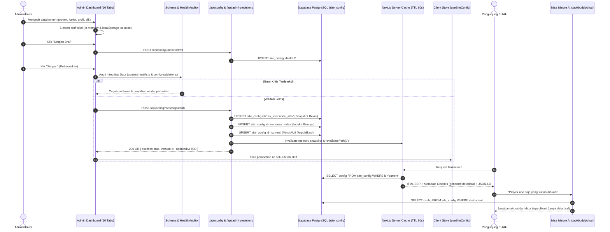

# ZekkTech CMS v3.5 — Data Flow & Architecture Specification

Dokumen spesifikasi arsitektur data, sinkronisasi cloud, siklus publikasi, dan mitigasi konkurensi untuk Portofolio ZekkTech (`https://zakariamp.vercel.app/`).

---

## 1. Diagram Alir Data Menyeluruh (End-to-End Data Pipeline)

---

## 2. Struktur Penyimpanan Supabase (`public.site_config`)

Tabel `site_config` menggunakan arsitektur JSONB berkinerja tinggi tanpa kebutuhan DDL migration berulang:

| `id` (PRIMARY KEY) | `config` (JSONB) | `updated_at` (TIMESTAMPTZ) | Deskripsi |
| :--- | :--- | :--- | :--- |
| `'current'` | Objek `SiteConfig` kanonikal terpublikasi | Waktu publikasi terakhir | Sumber kebenaran tunggal untuk seluruh pengunjung publik, metadata SEO, dan Miss Minute. |
| `'draft'` | Objek `SiteConfig` draf editor | Waktu simpan draf | Draf kerja administrator. Tidak pernah terekspos ke pengunjung publik. |
| `'rev_<ver>_<ts>'` | Objek snapshot revisi lengkap | Waktu pembuatan snapshot | Snapshot cadangan permanen untuk audit jejak perubahan dan rollback instan. |
| `'revisions_index'` | Array metadata revisi | Waktu revisi terbaru | Indeks ringkas daftar revisi untuk modal pemulihan versi. |

---

## 3. Strategi Mitigasi Masalah Data (Zero Slop & Anti-Corruption)

### A. Pencegahan Stale `localStorage` Menimpa Data Cloud
Pada `src/lib/site-store.ts`, fungsi `syncCloudConfig` memeriksa `STORAGE_TIMESTAMP_KEY`. Jika data yang diterima dari cloud memiliki timestamp lebih baru daripada cache lokal browser, snapshot memori langsung diperbarui dari cloud dan cache lokal ditimpa dengan data cloud terbaru.

### B. Isolasi Koleksi Kosong (No Resurrection)
`defaultProjects` pada `src/lib/site-store.ts` bernilai array kosong `[]`. Jika admin sengaja menghapus semua proyek, koleksi tetap kosong dan antarmuka merender status kosong yang bersih (*graceful empty state*), tanpa membangkitkan data dummy dari `profile.ts`.

### C. Proteksi Konkurensi & Unsaved Changes
- Hook `beforeunload` aktif pada `src/app/admin/admin-client.tsx` saat ada perubahan draf yang belum disimpan (`hasUnsavedChanges = true`).
- Konflik versi dideteksi sebelum penulisan cloud. Jika versi cloud lebih tinggi daripada draf dasar admin, editor memberikan peringatan sinkronisasi.

---

## 4. Pipeline Media Terverifikasi (Cloudflare R2 & Safe Cleanup)

1. **Kompresi WebP Otomatis**: Berkas gambar raster (PNG, JPG, JPEG) dikompresi menjadi format WebP di browser melalui Canvas API sebelum transmisi.
2. **Katalog & Pemindai Referensi**: `src/lib/content/media-catalog.ts` memindai seluruh URL yang terdaftar di konfigurasi aktif.
3. **Pencegahan Penghapusan Tidak Sengaja**: Rute `DELETE /api/upload` memeriksa apakah berkas sedang digunakan oleh proyek, sertifikat, avatar, atau latar belakang. Jika masih aktif, penghapusan dicegah dengan pesan peringatan referensi.
